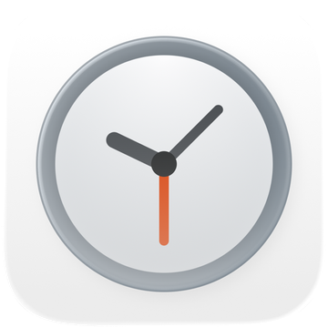

# 秒時計 by Live Seconds

**iPhone に秒を表示する時計。ホーム画面、ロック画面、Dynamic Island、そして枕元に。**

iOS 18 以降 · iPhone、iPad、iPhone Duo · 広告なし・アカウント不要・トラッキングなし

[English](README.md) · [简体中文](README.zh.md) · 日本語

---

iPhone は秒を表示しません。ロック画面もステータスバーも、Apple の時計ウィジェットも分まで。
秒時計はその隙間を埋めます。1 秒ごとに進む秒の表示を、見たい場所に置けます。

## できること

### ウィジェット

ロック画面の時計の下、または時計の上の小さな枠に秒を表示。ホーム画面では小・中・大
（iPad では特大も）から選べて、スタイルは透明、Liquid Glass、単色、グラデーション。

### フローティング時計

ほかのアプリを使っているあいだも、時刻を Dynamic Island に表示。ミリ秒まで出すこともできます。

### ナイトスタンド時計

日付・時刻・秒を表示する、落ち着いた全画面の時計。スタンド、デスク、スタンバイで、
縦向きでも横向きでも使えます。

### 自分好みに

内蔵フォントまたは端末内の任意のフォント、プリセットまたはカスタムのカラー、ライト／ダーク、
タイムゾーン表示と 0.1 秒表示。システムの文字サイズと 12/24 時間表示に従い、13 言語に対応。

### iPhone Duo とショートカット

iPhone Duo では縦向きでも横向きでも。秒時計のアクションは「ショートカット」と Siri で使えます。

## スクリーンショット

| ウィジェットのスタイル | 設定 | ロック画面 | ナイトスタンド |
|---|---|---|---|
|  |  |  |  |

[ほかのスクリーンショット](https://liveseconds.app/ja/#screens)

## 6.0.0 の新機能

- iPhone Duo に対応
- ショートカットと Siri のアクションに対応
- iOS 27 で Dynamic Island の時計のミリ秒表示を修正
- フローティング時計と「Dynamic Island に表示」の問題を修正
- iPhone ミラーリング時の表示を改善

[バージョン履歴](https://liveseconds.app/ja/releases)

## よくある質問

**iPhone のロック画面に秒を表示できますか？**

標準ではできません。秒時計を入れると、秒を表示するロック画面ウィジェットが使えます。

**ホーム画面にウィジェットを追加するには？**

ホーム画面を長押しし、「編集」→「ウィジェットを追加」をタップして「秒時計」を検索します。

**フローティング時計はバッテリーを消費しますか？**

いいえ。バックグラウンドで動くものはありません。

**対応デバイスは？**

iOS 18 以降の iPhone、iPhone Duo、iPad です（iOS 27 を含む）。

---

[App Store](https://apps.apple.com/jp/app/id6779098109) · [公式サイト](https://liveseconds.app/ja/)

**キーワード** · 秒時計 · iPhone 秒 表示 時計 · 秒表示 時計 iOS · 秒が見える ウィジェット · ロック画面 秒 ウィジェット ·
ホーム画面 時計 ウィジェット · 透明 ウィジェット · Liquid Glass ウィジェット · Dynamic Island 時計 ·
フローティング時計 · ナイトスタンド 時計 · ベッドサイド時計 · スタンバイ 時計 · ミリ秒 時計 iPhone ·
タイムゾーン ウィジェット · iPhone Duo 時計 ウィジェット · ショートカット 時計 · iOS 27 時計 ウィジェット ·
iOS 26 時計 ウィジェット

